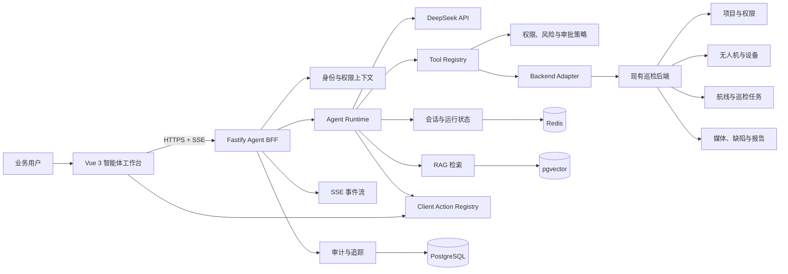
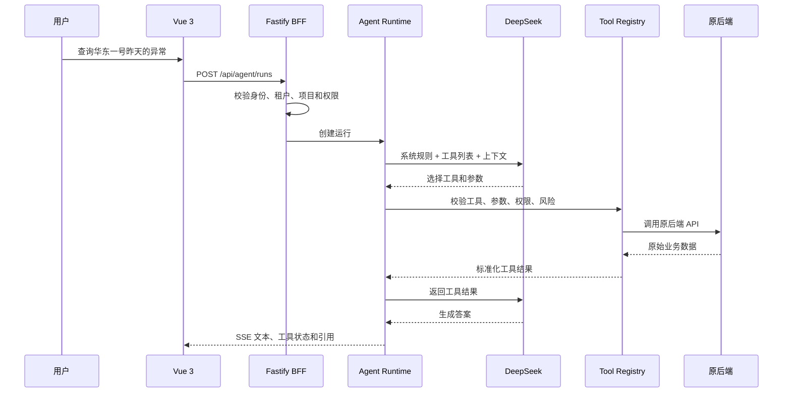
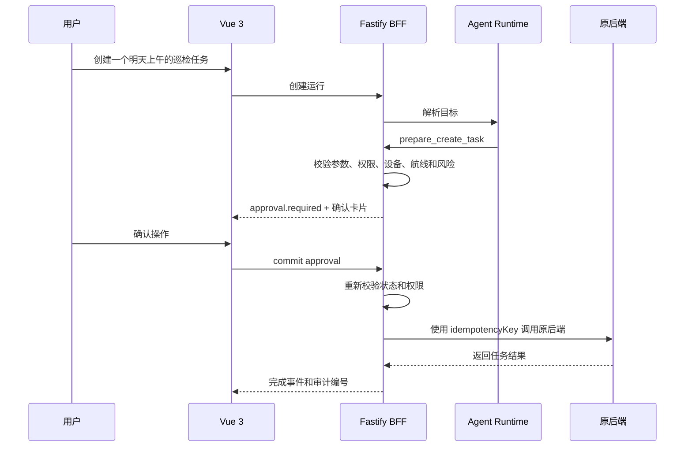
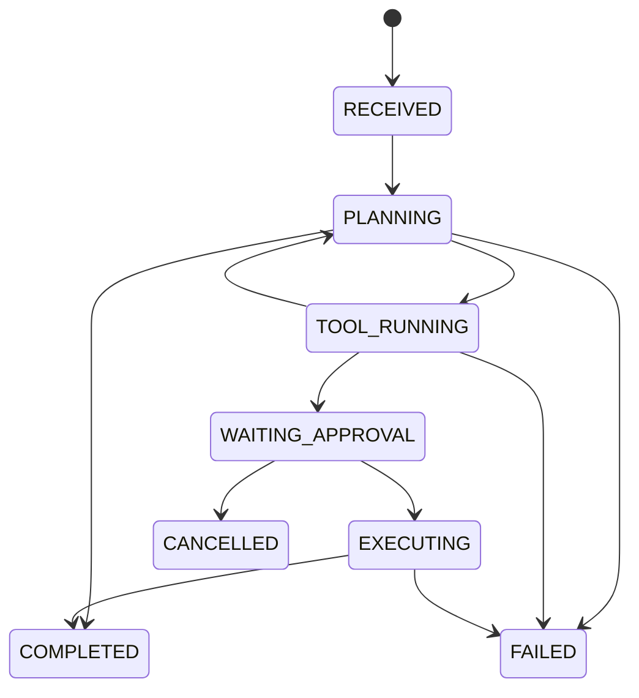
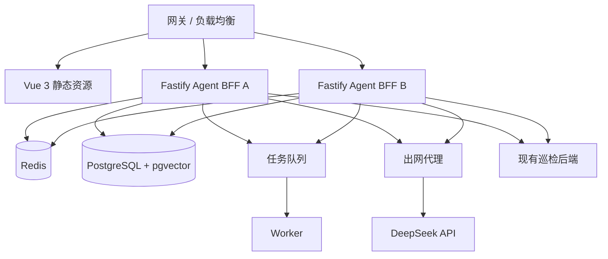

# 无人机巡检 AI 智能体架构

## 1. 文档目标

本文描述一个面向无人机巡检平台的 AI 智能体方案：

- 前端使用 Vue 3。
- Node 中间层使用 Fastify + TypeScript + Zod。
- 模型使用 DeepSeek。
- 原后端接口不修改。
- 用户通过自然语言查询数据并执行受控操作。
- 所有高风险操作经过权限校验、确认和审计。

本文既用于学习，也用于指导实际开发。

## 2. 产品能力

### 2.1 第一版只读能力

- 查询项目和项目权限。
- 查询无人机、设备状态和基础信息。
- 查询航线、巡检任务和任务状态。
- 查询缺陷、图片、视频和报告元数据。
- 对查询结果进行汇总、对比和解释。
- 回答巡检 SOP、法规和操作手册问题。

### 2.2 第二版受控写入

- 创建巡检任务草稿。
- 提交巡检任务。
- 生成报告草稿。
- 导出报告或结果。
- 取消符合条件的任务。

### 2.3 明确禁止

- Agent 不直接控制无人机起飞、返航或修改真实航线。
- Agent 不直接执行 SQL。
- Agent 不访问任意 URL。
- Agent 不使用管理员服务账号绕过用户权限。
- Agent 不根据模型输出直接执行未经确认的写操作。

## 3. 核心约束

1. 原后端不改接口。
2. 原后端仍是业务事实来源。
3. Node 只负责 BFF、Adapters、Agent Runtime、Tool Execution、审批和审计。
4. 模型只负责理解、规划和语言生成，不负责最终权限。
5. 高风险动作必须 prepare → 用户确认 → commit。
6. 写操作必须幂等。
7. 每次运行必须可追踪、可恢复、可审计。

## 4. 技术选型总结

### 4.1 Node 框架

最终选择：

```text
Node.js 22 + Fastify + TypeScript + Zod
```

选择原因：

- 请求模型简单，适合从 Vue 3 转 Node 的学习路径。
- 插件、Hook 和路由边界清晰。
- TypeScript 和 JSON Schema 体验良好。
- 易于实现 SSE、错误处理、日志和优雅停机。
- 不需要一开始引入 NestJS 的依赖注入、装饰器和模块抽象。

没有选择其他方案的原因：

| 方案 | 优点 | 当前不适用的原因 |
| --- | --- | --- |
| Express | 生态成熟、资料多 | 结构约束较弱，容易变成中间件堆叠 |
| NestJS | 企业级模块、DI、Guard、Pipe 完整 | 学习和抽象成本较高，MVP 阶段偏重 |
| 直接前端调用 DeepSeek | 表面简单 | 暴露模型 Key，无法控制工具、权限和写入 |

如果团队已经统一使用 NestJS，可以继续使用 NestJS；本项目的默认学习方案仍为 Fastify。

### 4.2 数据与运行组件

| 用途 | 选择 |
| --- | --- |
| 短期运行状态、锁、限流 | Redis |
| 会话、运行、工具调用、审批、审计 | PostgreSQL |
| 知识切片向量检索 | pgvector |
| 报告、附件、缩略图、导出文件 | 对象存储 |
| 长任务与批量任务 | Redis 队列 + Worker |

## 5. 总体架构



## 6. 关键调用链

### 6.1 只读查询



### 6.2 受控写入



## 7. Fastify 模块结构

```text
apps/
  agent-web/
    src/
      views/
      components/
      stores/
      api/
      types/

  agent-api/
    src/
      app.ts
      server.ts
      config/
      plugins/
        auth.ts
        errors.ts
        logging.ts
      modules/
        conversations/
        runs/
        approvals/
        audit/
      tools/
        registry.ts
        inspection-tools.ts
        task-tools.ts
      runtime/
        agent-runtime.ts
        state-machine.ts
        limits.ts
      model/
        deepseek-client.ts
        prompt-builder.ts
      adapters/
        backend-client.ts
        response-normalizer.ts
      storage/
        redis.ts
        postgres.ts
      jobs/
        report-worker.ts

packages/
  contracts/
    src/
      api/
      tools/
      errors/
```

## 8. 工具契约

每个工具都必须定义：

```ts
type ToolDefinition<TInput, TOutput> = {
  name: string
  description: string
  inputSchema: ZodSchema<TInput>
  outputSchema: ZodSchema<TOutput>
  permission: string
  risk: 'read' | 'draft' | 'write' | 'critical'
  timeoutMs: number
  idempotency: 'none' | 'optional' | 'required'
  execute: (input: TInput, context: ToolContext) => Promise<TOutput>
}
```

工具执行规则：

1. 模型只能输出工具名和候选参数。
2. Node 必须重新校验工具名和参数。
3. Node 必须检查用户、租户、项目、资源和动作权限。
4. 写工具必须绑定审批和幂等键。
5. 工具结果放大、脱敏、裁剪后才能进入模型上下文。

### 8.1 前端交互知识

前端交互文档可以作为 RAG 知识来源，帮助 Agent 理解页面、路由、表单、权限和用户操作流程。它解决的是“用户在哪里操作”，而不是“真实业务如何执行”。

适合进入知识库的内容：

- 页面和路由。
- 用户操作流程。
- 表单字段和校验。
- 权限和按钮可用性。
- 加载、空、错误和成功状态。
- 页面动作与服务端工具的映射。

### 8.2 客户端动作注册表

前端只执行注册过的 Client Action，不能让模型生成任意 JavaScript 或 DOM 选择器。

客户端动作示例：

- 打开创建表单。
- 路由跳转。
- 打开详情抽屉。
- 高亮和滚动到记录。
- 刷新指定查询缓存。
- 打开报告预览。

客户端动作只负责界面行为。真实业务读写仍然由 Server Tool 调用原后端，高风险动作仍然需要审批。

## 9. Agent Runtime 状态机



运行限制：

- 最大规划轮数：6。
- 最大工具调用次数：12。
- 单工具超时：5～15 秒。
- 总运行超时：60～180 秒。
- 写入工具重试必须依赖幂等键，不允许无条件重复执行。

## 10. SSE 事件协议

```ts
type AgentEvent =
  | { type: 'response.delta'; text: string }
  | { type: 'run.status'; status: RunStatus }
  | { type: 'tool.started'; name: string; args: unknown }
  | { type: 'tool.completed'; name: string; result: unknown }
  | { type: 'client.action'; action: string; params: unknown }
  | { type: 'approval.required'; approvalId: string }
  | { type: 'artifact.ready'; artifactId: string }
  | { type: 'run.completed'; answer: string }
  | { type: 'run.failed'; code: string; message: string }
```

事件必须包含运行 ID、事件序号和时间。连接断开后，客户端先查询持久状态，再从最后确认的事件继续。

## 11. 权限与安全

### 11.1 身份链路

```text
Vue 登录
  -> 携带 Token/Cookie 请求 Fastify
  -> Fastify 建立用户上下文
  -> 工具层检查权限
  -> Backend Adapter 使用用户身份调用原后端
  -> 原后端最终授权
```

### 11.2 安全要求

- DeepSeek Key 只存在 Node 服务端 Secret。
- JWT、Cookie、Token 不进入 Prompt 和日志。
- 外部文档和工具结果按不可信数据处理。
- 工具白名单、权限、风险和审批由代码决定。
- 确认卡片展示真实参数摘要，不只展示模型文案。
- 写操作必须有幂等键和审计记录。
- 模型输出 Markdown 必须安全渲染，禁止直接插入 HTML。
- 模型不能生成任意客户端 JavaScript，只能输出已注册动作 ID。

## 12. 数据模型

核心表建议：

- `conversation`
- `message`
- `agent_run`
- `agent_step`
- `tool_call`
- `approval`
- `artifact`
- `document`
- `document_chunk`
- `audit_event`
- `client_action_definition`

所有业务表带 `tenant_id` 和必要的时间、版本、状态字段。知识切片带项目、设备类型、文档版本、权限范围和生效日期。

## 13. 部署与运维



运行要求：

- Fastify 实例无状态，可水平扩容。
- SSE 配置心跳、超时和断线重连。
- 模型 Key 和原后端凭证进入 Secret Manager。
- 模型调用、工具、队列和原后端有统一 Trace。
- 用户级、项目级和全局都有并发与费用配额。

## 14. 验收标准

一个可用的第一版至少满足：

1. 用户能用自然语言完成 10 个真实只读问题。
2. 工具选择、参数和引用可追踪。
3. 越权项目、任务和设备访问全部被拒绝。
4. 模型不可用时，原平台业务仍能正常工作。
5. 高风险写入未确认时不会产生业务副作用。
6. 重复提交不会重复创建任务。
7. 页面刷新或 SSE 断线后可以恢复运行状态。
8. 模型、工具、Prompt 和成本都可以观测。
9. 前端动作只能调用白名单动作，未注册动作全部拒绝。

## 15. 相关文档

- [智能体工具契约](./ai-agent-tool-contract.md)
- [自研开发计划](./ai-agent-development-plan.md)
- [前端交互知识库与客户端动作](./frontend-interaction-knowledge.md)
