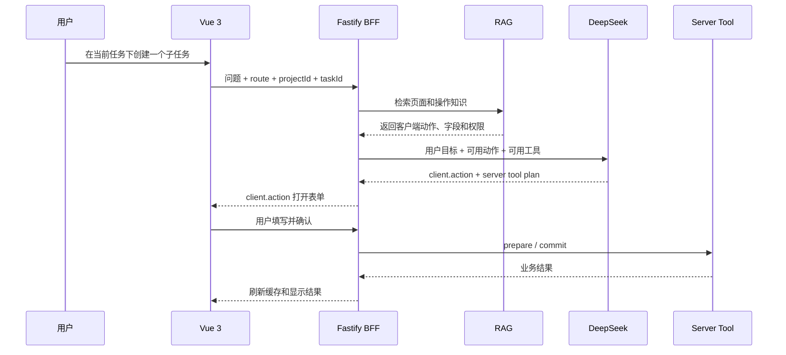

# 前端交互知识库与客户端动作

## 1. 目标

前端交互文档可以帮助 Agent 理解：

- 用户当前在哪个页面。
- 页面上有哪些合法操作。
- 操作需要哪些参数和权限。
- 操作前后有哪些 UI 状态。
- 应该打开哪个表单、详情页或确认卡片。

注意：前端交互知识库不会让 Agent 直接操作 DOM，也不会让模型生成任意 JavaScript。

## 2. 两层结构

### 2.1 RAG 阅读层

给 DeepSeek 阅读，用于理解页面和操作逻辑。

适合放入：

- 页面目标和路由。
- 页面状态和状态流转。
- 用户操作流程。
- 表单字段和校验规则。
- 权限和按钮可见性。
- 加载、空、错误和成功状态。
- 操作对应的后端工具。

### 2.2 客户端动作注册表

给 Vue 3 执行，只有注册过的动作才能被调用。

客户端动作包括：

- 路由跳转。
- 打开抽屉、弹窗或详情面板。
- 打开并预填表单。
- 高亮记录、滚动到指定区域。
- 刷新指定查询缓存。
- 打开报告或媒体预览。

客户端动作不包括：

- 直接执行任意 JavaScript。
- 直接调用原后端写接口。
- 直接修改 DOM。
- 绕过 Node 权限和审批。

## 3. 服务端工具与客户端动作的区别

| 类型 | 在哪执行 | 作用 | 示例 |
| --- | --- | --- | --- |
| Server Tool | Fastify / Node | 查询或修改真实业务 | 查询任务、创建任务 |
| Client Action | 浏览器 / Vue 3 | 改变用户界面状态 | 打开表单、跳转详情 |
| 审批 | Fastify + Vue 3 | 暂停高风险操作并确认 | 创建任务确认 |

一次自然语言操作可以同时包含三种：

```text
用户：在当前任务下创建子任务

1. 前端动作：打开创建子任务表单，并预填 parentTaskId。
2. 服务端工具：查询项目、任务和权限。
3. 用户确认：展示创建摘要。
4. 服务端工具：commit 创建任务。
5. 前端动作：跳转到新任务或刷新任务列表。
```

## 4. 客户端动作契约

```ts
type ClientActionDefinition<TParams> = {
  id: string
  description: string
  paramsSchema: ZodSchema<TParams>
  permission?: string
  preconditions: string[]
  result: string
  handler: (params: TParams) => Promise<void> | void
}
```

示例：

```ts
const OpenCreateSubtaskForm = defineClientAction({
  id: 'task.open_create_form',
  description: '打开创建子任务表单，并预填父任务',
  paramsSchema: z.object({
    projectId: z.string().uuid(),
    parentTaskId: z.string().uuid(),
  }),
  permission: 'task:create',
  preconditions: ['当前用户拥有 task:create 权限'],
  result: '打开创建表单',
  handler: ({ projectId, parentTaskId }) => {
    router.push({
      name: 'task-create',
      params: { projectId },
      query: { parentTaskId },
    })
  },
})
```

Agent 输出的是动作意图：

```json
{
  "type": "client.action",
  "action": "task.open_create_form",
  "params": {
    "projectId": "p-001",
    "parentTaskId": "t-100"
  }
}
```

Vue 3 收到后只执行白名单动作，不执行模型生成的代码。

## 5. 交互文档切片

建议按以下结构存储：

```json
{
  "type": "page_action",
  "appVersion": "2026.10.14",
  "route": "/projects/:projectId/tasks/:taskId",
  "pageId": "task-detail",
  "actionId": "task.open_create_form",
  "description": "创建子任务",
  "permission": "task:create",
  "params": {
    "projectId": "string",
    "parentTaskId": "string"
  },
  "preconditions": [
    "任务存在",
    "用户有 task:create 权限"
  ],
  "uiResult": "打开表单并预填父任务",
  "serverTool": "prepare_create_task",
  "sourcePath": "src/views/task/detail/TaskDetailView.vue"
}
```

每个切片都要带：

- 应用版本。
- 路由。
- 页面 ID。
- 动作 ID。
- 权限。
- 参数 Schema。
- 前置条件。
- UI 结果。
- 关联服务端工具。
- 源码或文档引用。
- 更新时间。

## 6. 运行时流程



## 7. 权限和版本

交互文档可能包含内部页面、字段和权限信息，因此需要：

- 按租户、角色和项目过滤。
- 不记录敏感账号和业务数据。
- 记录前端版本和路由版本。
- CI 检查动作清单和真实路由是否一致。
- 文档过期时停止返回对应动作。

## 8. 不适合给 Agent 的内容

- CSS 颜色、像素和动画细节。
- 内部组件实现的任意代码。
- DOM 选择器和事件监听细节。
- 未脱敏截图。
- Token、用户隐私和真实业务数据。
- 未经权限保护的源码或接口说明。

## 9. 评测

至少覆盖：

- 用户说“这个页面”时能否识别当前路由。
- 能否选择正确的前端动作。
- 缺少参数时是否追问。
- 无权限时是否拒绝打开动作。
- 是否把 UI 动作误当成服务端写操作。
- 是否生成未注册的客户端动作。
- 版本更新后旧动作是否被淘汰。

## 10. 结论

前端交互文档可以直接作为知识库，但要区分：

- RAG 负责理解和规划。
- Client Action Registry 负责安全执行界面动作。
- Server Tool 负责真实业务读写。
- 审批负责高风险动作。

只有四者分开，Agent 才能知道用户怎么操作，同时不越过前端、Node 和后端的权限边界。
